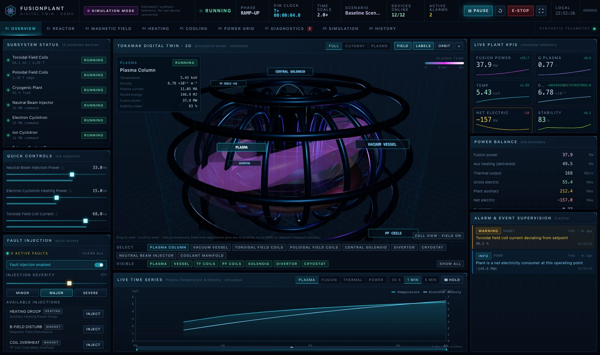
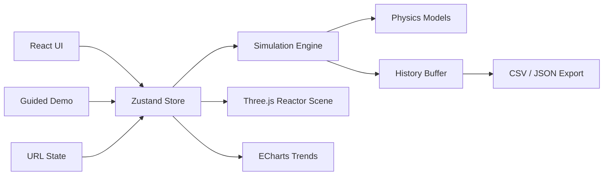
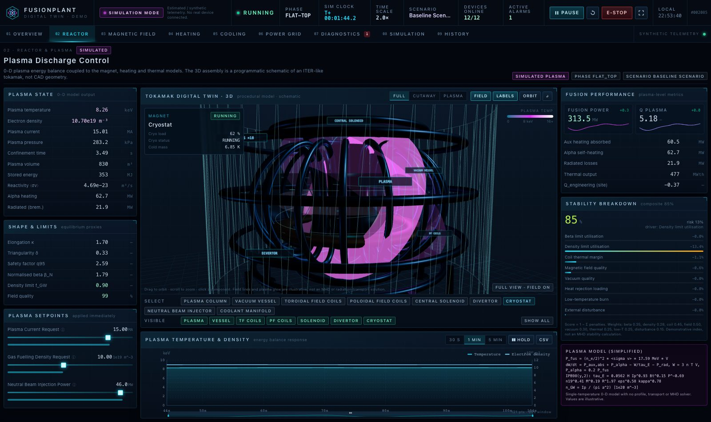
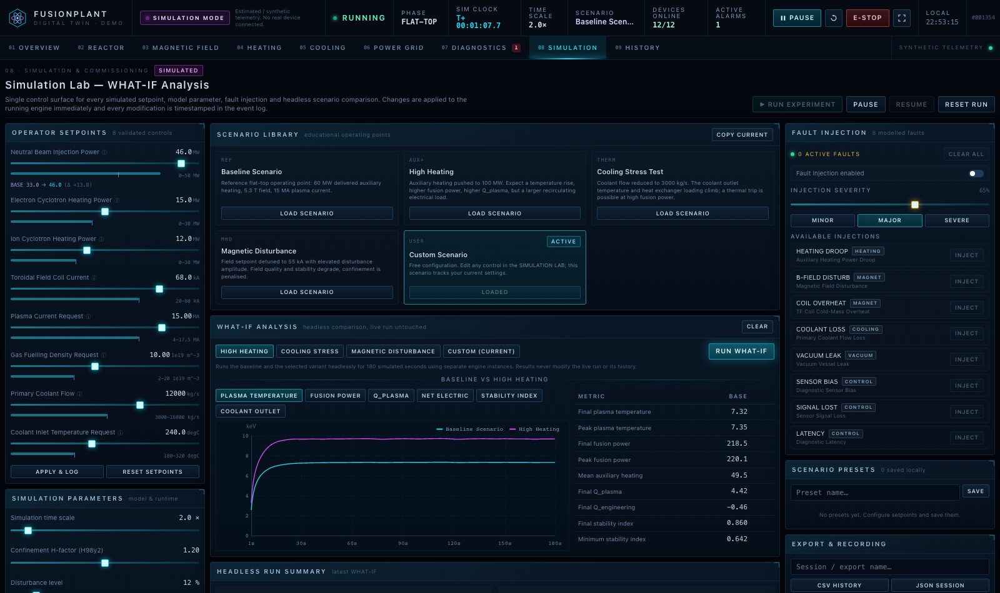
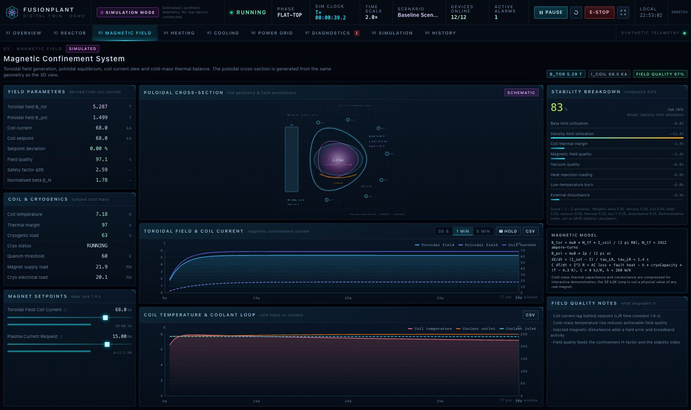
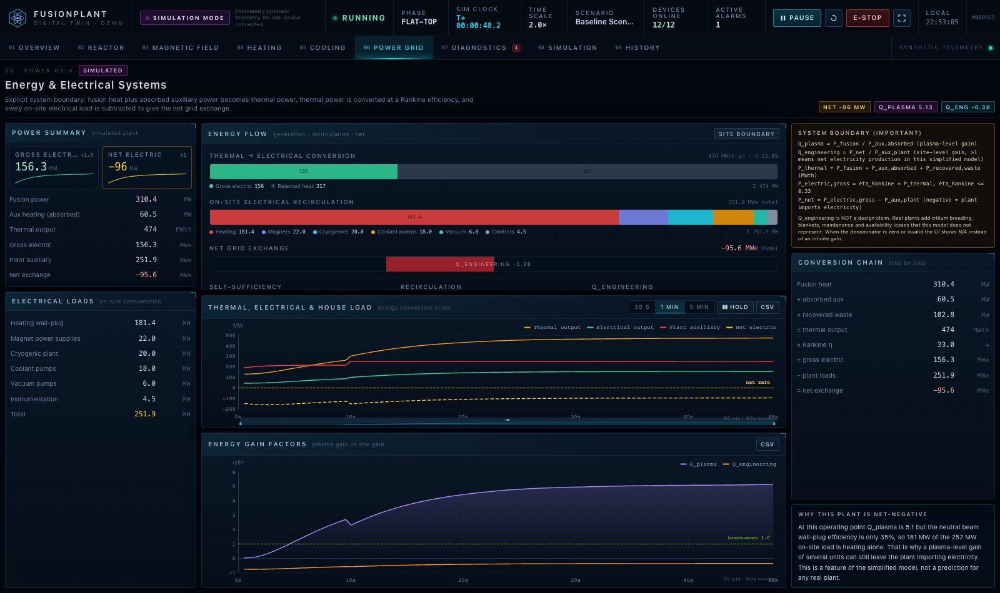
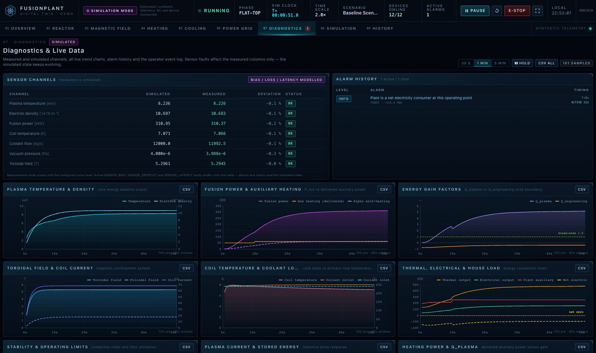
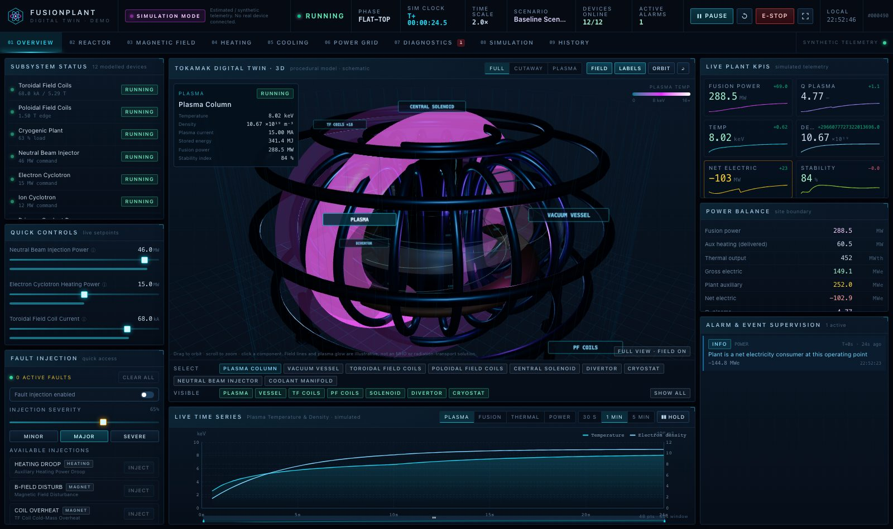

# FusionPlant Digital Twin · **v1.2.1**

**An interactive, fully local fusion-plant digital twin: a real-time simulation engine, a procedural 3D tokamak, and an industrial operations console.**

[](https://github.com/paulwang20110424-commits/fusionplant-digital-twin/actions/workflows/ci.yml)


> ⚠️ **SIMULATION ONLY.** Every number in this application is generated by a local,
> simplified 0-D physics model. Nothing is measured, nothing is commanded, and
> nothing is connected to a real fusion device. The model is an educational and
> software-validation artefact — it cannot predict the behaviour of any real
> tokamak and must never be used for engineering, safety or operating decisions.

**Live demo:** run it locally — `npm install && npm run dev` → <http://localhost:5174>.
(No hosted demo: the project has no backend, no accounts and makes no network calls.)

**New to the project?** Press **RUN GUIDED DEMO** on the overview page. A nine-step
walkthrough takes about three minutes and introduces the simulation, the controls,
the 3D twin, fault injection, history replay and scenario comparison.



---

## 30 seconds to understand the project

1. Press **START** — the simulated plant ramps up; charts and KPIs start moving.
2. Drag **Neutral Beam Injection power** to ~40 MW — temperature, fusion power and
   Q_plasma respond within seconds.
3. Read the **plasma KPIs** (temperature, density, stored energy, stability).
4. Inject **COOLANT LOSS** in the fault panel — outlet temperature climbs, alarms fire.
5. Clear the fault — the plant returns towards its previous operating point.
6. Open **HISTORY** → _Capture live buffer_ and scrub the recording.
7. Open **SIMULATION** → _Run WHAT-IF_ to compare two operating scenarios headlessly.

---

## Architecture



**Single source of truth.** `FusionSimulationEngine` owns all state and steps at a
fixed 50 ms simulated interval. The store publishes immutable snapshots at 12 Hz;
charts read a ring buffer at 4 Hz; the 3D scene reads live state per frame. No
component invents or perturbs a number.

```
src/
  config/version.ts           # APP_VERSION / MODEL_VERSION / EXPORT_SCHEMA_VERSION
  simulation/                 # pure TypeScript, no React/DOM
    FusionSimulationEngine.ts # integrator, fault effects, snapshots, headless runs
    PlasmaModel.ts MagneticFieldModel.ts HeatingModel.ts
    ThermalModel.ts PowerBalanceModel.ts StabilityModel.ts
    AlarmEngine.ts faults.ts controlSpecs.ts scenarios.ts random.ts tokamakGeometry.ts
  reactor/componentRegistry.ts# 3D ↔ equipment ↔ page ↔ fault mapping
  guidedDemo/steps.ts         # tour definition (pure data)
  store/                      # Zustand stores, selectors, history buffer
  components/                 # layout, charts, reactor, panels, controls, demo, ui
  pages/                      # nine console pages (lazy-loaded)
  utils/                      # units, validation, export, alarms, trend, urlState
  tests/                      # 129 unit tests
scripts/                      # audit, a11y, build stats, version + asset checks
```

---

## Feature overview

| Area            | What works                                                                                                                                                                                                          |
| --------------- | ------------------------------------------------------------------------------------------------------------------------------------------------------------------------------------------------------------------- |
| Simulation      | 0-D plasma energy balance, IPB98(y,2) confinement, fusion power, coil slew + cold-mass thermal balance, coolant loop, Rankine conversion, explicit site power balance, composite stability score, rule-based alarms |
| Console         | 9 pages, live KPIs, dense charts, event log, 16:9 layout with tablet fallback                                                                                                                                       |
| 3D              | Procedural vessel/TF/PF/solenoid/divertor/cryostat, orbit+zoom, component picking, cutaway & plasma views, per-structure visibility, hover tooltips, fault markers                                                  |
| Control         | 8 validated setpoints, latency effects, immediate feedback, keyboard + screen-reader accessible                                                                                                                     |
| Faults          | 8 injectable faults with severity, diagnosis, affected parameters and simulated recovery steps                                                                                                                      |
| Analysis        | WHAT-IF headless comparison (15 metrics + overlays), scenario presets, A/B history compare                                                                                                                          |
| Data            | Ring-buffer history, local session save/import/rename/export, replay, CSV/JSON with provenance                                                                                                                      |
| Reproducibility | Seeded PRNG, stable run id, run-configuration export, "reproduce run"                                                                                                                                               |
| Shareability    | URL mirrors page, scenario, seed, 3D view and selected component                                                                                                                                                    |

---

## Quick start

```bash
npm install          # once
npm run dev          # http://localhost:5174
```

| Command                           | Purpose                                                     |
| --------------------------------- | ----------------------------------------------------------- |
| `npm run dev`                     | Vite dev server on port 5174                                |
| `npm run build`                   | Type-check + production build into `dist/`                  |
| `npm run preview`                 | Serve the production build                                  |
| `npm test`                        | 129 unit tests (Vitest)                                     |
| `npm run typecheck`               | TypeScript only                                             |
| `npm run lint` / `lint:fix`       | ESLint (TS, React Hooks, jsx-a11y)                          |
| `npm run format` / `format:check` | Prettier                                                    |
| `npm run version:check`           | All version sources agree                                   |
| `npm run check:assets`            | Documentation screenshots exist                             |
| `npm run audit` / `audit:tablet`  | Headless browser interaction + layout audit                 |
| `npm run test:a11y`               | axe-core WCAG 2 A/AA check                                  |
| `npm run stats`                   | Build size report (soft budgets)                            |
| `npm run verify`                  | version → assets → typecheck → lint → format → test → build |

Requirements: Node 20.19+ or 22.12+, npm, and Chrome for the browser audits.
TypeScript is pinned to **6.0.x** because TypeScript-ESLint does not yet support the
TypeScript 7 API (see `CHANGELOG.md`).

---

## Reproducibility

A run is fully determined by `(randomSeed, scenario, controls, initial conditions,
fault timeline, time step)`. The engine never calls `Math.random()`; every stochastic
effect draws from a seeded mulberry32 generator.

- The **Simulation Lab** shows the live `runId`, the seed and the model version.
- **Copy config** places a JSON record of the current run on the clipboard.
- **Reproduce run** restarts the run from the same seed and initial state.
- Exports carry `runId`, `randomSeed`, `scenario`, `timeScale`, `appVersion` and
  `modelVersion`; imported files are validated and incompatible schemas are refused
  instead of being replayed incorrectly.

## Data schema & replay

```jsonc
{
  "application": "FusionPlant Digital Twin",
  "appVersion": "1.2.0",
  "modelVersion": "1.0.0",
  "exportSchemaVersion": 1, // additive changes keep schema 1
  "exportVersion": 1, // legacy alias for v1.0.0 readers
  "exportedAt": "…",
  "runId": "FUS-20260101-…",
  "randomSeed": 20260101,
  "scenario": "Baseline Scenario",
  "timeScale": 2,
  "session": { "samples": [], "events": [], "alarms": [], "controls": {}, "faults": [] },
}
```

Replay is read-only: it operates on an immutable copy of recorded samples and cannot
advance, rewind or otherwise modify the live engine or its history buffer.

## Model assumptions (short version)

- Single-temperature 0-D plasma; IPB98(y,2) confinement with an adjustable H-factor
  (default 1.2, an enhanced-confinement assumption).
- Neutronics, tritium breeding, current drive, MHD stability and profile transport
  are **not** modelled. The "stability index" is a weighted penalty score.
- Thermal capacitances and transport lags are compressed so transients are visible in
  an interactive session.
- Reference machine geometry is a generic ITER-like DEMO envelope, not any real
  device's parameters. See the in-app model panels for every equation.

## Known limitations

0-D physics only · procedural (non-CAD) geometry · no tritium cycle or neutronics ·
instantaneous startup · SCRAM is a latch without a shutdown sequence · compressed
time constants · single-track replay with A/B comparison · English UI (Chinese
summary below) · charts retained in memory only (≤4 800 samples) · the browser audit
runs outside the unit-test suite.

## Accessibility

Accessible names on all controls, `aria-current` page navigation, switch semantics,
slider `aria-valuetext`, `aria-live` status regions, a skip link, visible
`:focus-visible` rings, and text labels accompanying every colour-coded state.
`npm run test:a11y` runs axe-core against four pages and fails on serious or critical
violations.

## Performance

- Engine 12 Hz publish / charts 4 Hz refresh / 3D reads state per frame — the React
  tree never renders at 60 Hz.
- History is a bounded ring buffer (4 800 samples) with no unbounded growth.
- Pages and the 3D scene are code-split; `npm run stats` reports entry and chunk sizes.
- `THREE.Clock` deprecation comes from `@react-three/fiber`'s frame clock, not project
  code; it is a console warning with no behavioural impact and is tracked upstream.

## Data, privacy and security

No backend, no accounts, no analytics, no network calls. Sessions live in
`localStorage` and never leave the browser. **Do not put secrets in `VITE_` variables** —
they are inlined into the client bundle. See `.env.example`.

## CI

GitHub Actions runs on pushes and pull requests to `main`:

1. **Verify** (Node 20 + 22): `npm ci` → version check → asset check → typecheck →
   lint → format check → tests → build → size report, with the `dist` artefact uploaded.
2. **Browser audit** (Node 22): builds, serves the production bundle, runs
   `npm run audit`, `npm run audit:tablet` and `npm run test:a11y`, and uploads
   `.smoke/` screenshots and reports even on failure.

## Changelog

See [CHANGELOG.md](CHANGELOG.md) — v1.2.1 "Complete Verification", v1.2.0 "Reproducible Twin" and the v1.0.0 baseline.

## Screenshots

| Reactor 3D                                  | Simulation Lab                                  |
| ------------------------------------------- | ----------------------------------------------- |
|  |  |

| Magnetic field                                        | Power grid                                      |
| ----------------------------------------------------- | ----------------------------------------------- |
|  |  |

| Diagnostics                                      | Fault injection                                 |
| ------------------------------------------------ | ----------------------------------------------- |
|  |  |

More context in [`docs/screenshots/`](docs/screenshots/README.md).

## Issues and contributions

Bug reports and feature requests use the issue templates in `.github/ISSUE_TEMPLATE/`.
Please check _Known limitations_ first, redact any credentials, and run `npm run verify`
before opening a pull request. Physics changes must state the equation and its units.

## License

[MIT](LICENSE). All dependencies are MIT or Apache-2.0. The licence covers this
repository's source code; the models are educational approximations with no warranty.

---

## 中文说明

**FusionPlant Digital Twin v1.2.0** 是一个可在浏览器中直接运行的交互式核聚变工厂数字孪生
演示平台，用于教学与软件验证，**不连接任何真实设备，也不控制任何真实反应堆**。

```bash
npm install && npm run dev    # 打开 http://localhost:5174
```

- **首次访问**：点击总览页左下角 **RUN GUIDED DEMO**，9 步引导约 3 分钟，涵盖启动仿真、
  调节 NBI 功率、观察等离子体、探索三维装置、注入/清除模拟故障、记录历史、运行 WHAT-IF。
- **9 个页面**：总览、反应堆、磁场、加热、冷却、电力、诊断、仿真实验台、历史记录。
- **可复现运行**：相同 seed + 相同工况 + 相同初始条件 + 相同故障时间线 ⇒ 相同结果；
  实验台可查看 runId / seed / 模型版本，支持复制运行配置与重放。
- **数据可追溯**：所有导出（CSV / JSON）都带 `appVersion`、`modelVersion`、
  `exportSchemaVersion`、`runId`、`randomSeed`、`scenario`、`timeScale` 与模拟数据声明；
  支持导入旧版本（v1.0.0）导出文件。
- **告警语义**：`CRITICAL` / `WARNING` 计入 Active Alarms，`INFO` 单独作为 Notices 展示。
- **无障碍**：全部控件具备可访问名称，键盘焦点可见，`npm run test:a11y` 使用 axe-core 检查。

所有数据均为**模拟 / 演示数据**，界面持续显示 `SIMULATION MODE`，导出文件带有
`SIMULATED / DEMO DATA` 声明。模型经过大量简化（0-D 物理、无剖面与输运求解、无氚循环与
中子学），**不可用于任何真实装置的设计、运行或安全决策**。

## Design language

Dark industrial control-room palette: near-black blue surfaces, cyan for nominal
telemetry, violet/magenta for plasma and field visualisation, amber for warnings, red
for faults. Hairline grid textures, corner ticks, monospaced tabular numbers, dense but
grouped layout, 16:9-first with a tablet-safe stacking layout. No game-style UI, no
decorative fake telemetry.
